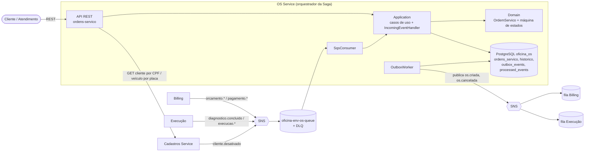
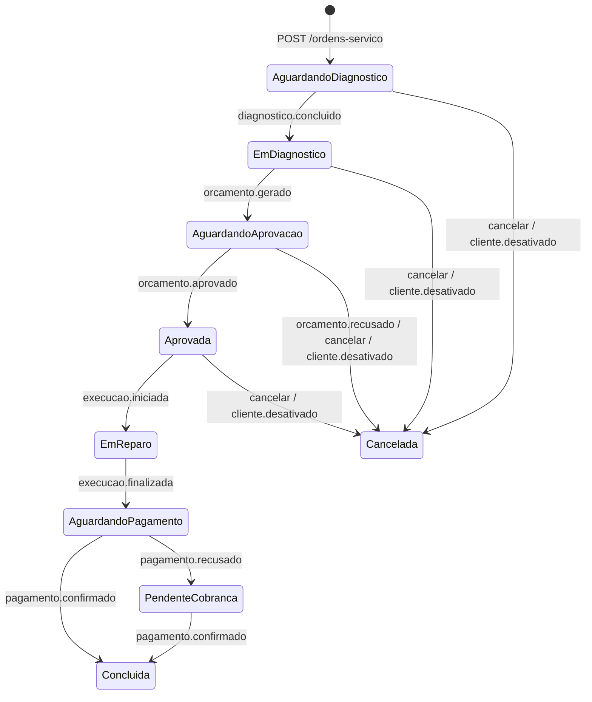

# Arquitetura do OS Service

O OS Service gerencia o ciclo de vida da Ordem de Serviço e é o **orquestrador da Saga** (ver [ADR 0001](adr/0001-saga-orquestrada.md)). Banco próprio: PostgreSQL `oficina_os`. Ninguém lê o banco dele e ele não lê o banco de ninguém: fala com o Cadastros por REST e com os demais por eventos.

## Visão geral

## Camadas (Clean Architecture)
| Camada | Responsabilidade |
|---|---|
| Domain | `OrdemServico`, `HistoricoStatusOS`, estados, eventos de domínio; sem dependência externa |
| Application | casos de uso (abrir, cancelar, consultar), `IncomingEventHandler` (aplica eventos recebidos), portas (`ICadastrosClient`, repositórios, publisher) |
| Infrastructure | EF Core/Npgsql, cliente HTTP do Cadastros, Outbox (`OutboxProcessor`/`OutboxWorker`), SNS, SQS (`SqsConsumer`) |
| API | controllers, tratamento de erros (404/403/400/409/503), health `/health/live` e `/health/ready` |

## Máquina de estados

Cancelamento só até `Aprovada`. Transição inválida lança exceção de domínio; no consumer vira log + ack (evento atrasado ou duplicado não trava a fila).

## Outbox (publicar com garantia)
Cada mudança grava a OS **e** uma linha em `outbox_events` na **mesma transação**. O `OutboxWorker` publica no SNS em ordem e marca como enviada; se o SNS falhar, tenta de novo (até `MaxAttempts`). Garantia *pelo menos uma vez*; por isso os consumidores deduplicam.

## Consumo e idempotência
O `SqsConsumer` lê `oficina-{env}-os-queue` (long polling). O `eventId` é gravado em `processed_events` **na mesma transação** da mudança de estado; entrega repetida é ignorada. Falha técnica ou mensagem malformada: não apaga a mensagem, e após 3 recebimentos a redrive policy a envia para a DLQ.

## Rastreamento
O `correlationId` (W3C `traceparent`) nasce na requisição HTTP, vai no envelope dos eventos, é retomado ao consumir e aparece nos logs estruturados. O agente do New Relic é injetado por init container.

## Infraestrutura e deploy
- Terraform (`terraform/`): tópicos `os.criada`/`os.cancelada` + ARNs no SSM, fila + DLQ, subscriptions (`raw_message_delivery = true`) e policies de recurso para a `LabEksNodeRole` (AWS Academy não permite IRSA).
- Kubernetes (`k8s/`): Deployment (+ init container New Relic), Service (NLB), HPA, ConfigMap; Secret criado por `scripts/deploy-k8s.sh`.
- CI/CD (`.github/workflows/`): `ci.yml` (build, testes, cobertura ≥ 80%, Sonar, imagem no GHCR) e `deploy.yml` (deploy em homolog/prod). Detalhes em [DEPLOY.md](DEPLOY.md).

## Dados
`ordens_servico` (id, status, clienteId, veiculoId, defeitoRelatado, diagnosticoId, orcamentoId, pagamentoId, criadaEm, atualizadaEm), `historico_status_os` (anterior, novo, quando, motivo), `outbox_events`, `processed_events`. A OS guarda apenas **IDs** de cliente e veículo.
